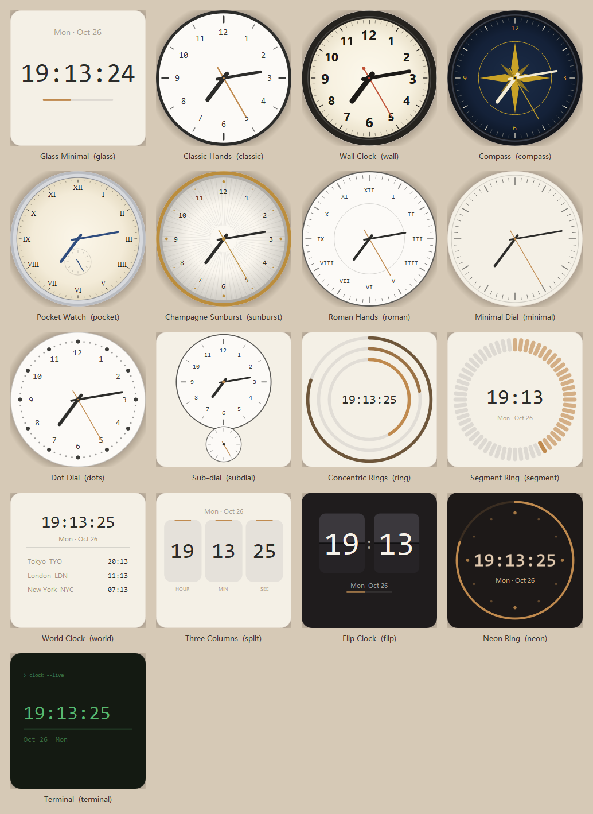

# DesktopClock

[简体中文](README.md) | **English**

A desktop clock widget for Windows. 17 vector skins, 10 colour themes, three window layers. Everything is drawn with QPainter — **no image assets at all** — using about 47 MB of RAM and 0.00% CPU when idle. The interface switches between Chinese and English.




---

## Features

- **17 skins** — digital, analogue and geometric, from a bare glass panel to a split-flap board, neon ring or terminal
- **Eight round dials** — the area outside the circle is fully transparent, so the dial sits directly on your wallpaper with a circular shadow
- **Independent hand and tick weight** — two 0.5–3.0 multipliers in 0.1 steps, tuned separately
- **10 colour themes** — warm beige / ink black / cool grey / celadon / amber / sakura / deep sea / pure white / graphite / paper white
- **Three window layers** — always on top, normal, or desktop widget (above the wallpaper, below the icons)
- **Borderless** — drag to move, scroll to resize, edge snapping, adjustable corner radius and shadow
- **Frosted glass** — optional DWM blur behind the panel
- **Lunar calendar and 24 solar terms** — pure offline astronomy, no network access
- **Multiple time zones** — the World Clock skin shows up to four extra cities
- **Light on resources** — vector drawing, timers aligned to whole seconds, no polling loop
- **Self-healing** — every exception is logged, and a stalled refresh timer is restarted automatically

---

## Requirements

| | |
|---|---|
| OS | Windows 10 / 11 (64-bit) |
| Python | 3.9+ (source build only) |
| Dependencies | PyQt5 5.15, tzdata |

---

## Quick start

```bash
git clone https://github.com/tiantianw/desktop-clock.git
cd desktop-clock

python -m venv .venv
.venv\Scripts\pip install -r requirements.txt

.venv\Scripts\pythonw run.pyw
```

You can also double-click `start_clock.vbs` (no console window).

The clock appears in the top-right corner and a dial icon shows up in the system tray.

### Command line

```
run.pyw --settings      # open the settings panel right after launch
```

### Quit

Right-click the clock → **Quit**, or right-click the tray icon → **Quit**.

---

## Packaging into a single folder

```bash
.venv\Scripts\pip install pyinstaller
.venv\Scripts\python -m PyInstaller build_tools/DesktopClock.spec --noconfirm
```

The result lands in `dist/DesktopClock/`. Copy that whole folder to any Windows 10/11 machine — no Python required.

The spec trims three layers: a `BLOCK_BIN` blacklist drops unused DLLs, a plugin whitelist keeps only `qwindows`/`qico`, and `TZ_KEEP` keeps only the time zone files the city table actually uses. Final size: 45 MB / 89 files.

---

## Interaction

| Action | Result |
|---|---|
| Left-drag | Move the clock |
| Scroll wheel | Resize (80–600 px) |
| Double-click | Toggle 12 / 24-hour |
| Right-click | Context menu |
| Release near a screen edge | Snap to it |
| `Ctrl+Alt+T` | Cycle through the three layers |
| `Ctrl+Alt+H` | Show / hide |

Click the tray icon to show or hide the clock; right-click for the full menu.

> On the desktop widget layer the desktop itself receives mouse events, so the clock cannot be dragged. Switch back with the hotkey or the tray menu first.

---

## 17 skins

| Skin | What it looks like | Good for |
|---|---|---|
| Glass Minimal | Large monospaced digits with a second bar | Light wallpapers, cleanest look |
| Classic Hands | Black rim, white face, Arabic numerals, red second hand | Traditional wall clock feel |
| Wall Clock | Thick black bezel, cream domed face, bold hands, red second hand | Closest to a real clock on the wall |
| **Compass** | Deep navy face with a gold compass rose | Dark wallpapers, best at night |
| **Pocket Watch** | Ivory face, serif Roman numerals, blued hands, sub-dial at six | Old pocket watch feel |
| **Champagne Sunburst** | Sunburst-textured face, gold rim and hands, follows the theme colour | Quiet luxury |
| **Dot Dial** | Sixty dots instead of ticks — not a single straight line | Soft and clean |
| Roman Hands | Roman numerals, thin rim | Classical |
| Minimal Dial | No numerals, just ticks and two slim hands | Minimal desktops |
| Sub-dial | Main dial for hours and minutes, small dial for seconds | Watch enthusiasts |
| Concentric Rings | Three arcs for hour, minute and second | Modern |
| Segment Ring | A 60-cell ring that lights up one cell per second | A sense of time passing |
| World Clock | Local time plus up to four cities | Working across time zones |
| Three Columns | Hour, minute and second in separate blocks | High information density |
| Flip Clock | Dark split-flap cards | Airport board feel |
| Neon Ring | Glowing ring on a dark plate | Dark wallpapers |
| Terminal | Monospaced green text, blinking cursor | Geeky |

Switch with right-click → **Skin**, the tray menu, or the thumbnails on the first settings tab.

> Flip / Neon / Terminal paint their own dark background and ignore the background settings. That is by design.

> Classic Hands / Wall Clock / Compass / Pocket Watch / Champagne Sunburst / Roman Hands / Minimal Dial / Dot Dial are **round dials**: everything outside the circle is fully transparent, the shadow turns circular too, and no card background is left in the corners — the dial sits straight on your wallpaper.
> The corner-radius setting has no effect on them, because a circle has no corners. They also can't use the frosted-glass background: the system blur only works on the whole window rectangle, which would smear into a visible square, so it falls back to a solid fill.

---

## Three window layers

Right-click → **Layer**, or the tray menu, or `Ctrl+Alt+T` to cycle.

| Layer | Behaviour |
|---|---|
| **Always on top** | Above normal windows, always visible. Re-asserted every 5 seconds so other topmost windows can't push it down |
| **Normal window** | Behaves like any other window and can be covered |
| **Desktop widget layer** | Above the wallpaper, below the desktop icons — it looks painted onto the desktop. Covered by every window; visible again when you show the desktop |

How it works: the desktop layer triggers the `Progman` → `WorkerW` split, then attaches the window with `SetParent`. Switching to this layer rebuilds the window (changing the parent destroys Qt's translucent surface), so you will see a brief flicker — that is expected. If attaching fails it falls back to always-on-top and writes a log line.

---

## Settings

Right-click → **Settings…**. Four tabs; **every change applies immediately, no restart**.

- **Skin** — 17 thumbnails, rendered live with the current colours
- **Appearance** — size 80–600 px, corner radius 0–40 px, 10 theme presets, background / text / accent / border colours, background mode (none / solid / frosted glass), opacity, border and shadow toggles, font and weight, **hand weight / dial ticks**
- **Content** — 12/24-hour, show seconds, second-hand style (tick / sweep / none), date format, weekday display, lunar calendar and solar terms, extra time zones
- **Behaviour** — **interface language (简体中文 / English)**, window layer, topmost guard, lock position, click-through, edge snapping, start with Windows

### Hands and ticks

Two independent multipliers, both default to `1.0`, step `0.1`, range `0.5 – 3.0`:

| Setting | What it scales |
|---|---|
| **Hand weight** | Stroke width of the hour, minute and second hands, plus the centre cap. Length is unchanged |
| **Dial ticks** | Width and length of the tick marks, plus the numeral size |

Dial ticks only apply to round-dial skins — digital and geometric skins have no ticks to scale. Numeral size has a built-in ceiling so that cranking it to 3.0 doesn't smear the numbers off the dial; if you want the whole clock bigger, use **Clock size** instead.

---

## Configuration file

Location: `config.json` next to the program (beside the exe in a packaged build). Created on first run. Edit it and restart, or delete it to restore the defaults.

```json
{
  "language": "zh",
  "skin": "glass",
  "theme": "warm",
  "geometry": { "x": null, "y": null, "size": 110 },
  "layer": "topmost",
  "appearance": {
    "radius": 18,
    "bg_mode": "solid",
    "bg_color": "#FAF6EE",
    "bg_opacity": 92,
    "accent": "#C08A4E",
    "text_color": "#2C2C2A",
    "muted_color": "#A0937F",
    "font_family": "Consolas",
    "font_weight": 500,
    "shadow": true,
    "shadow_strength": 20,
    "border": true,
    "border_color": "#E7DFD2",
    "dial_style": "arabic",
    "hand_scale": 1.0,
    "dial_scale": 1.0
  },
  "content": {
    "hour24": true,
    "show_seconds": true,
    "second_style": "tick",
    "date_format": "MM月DD日",
    "show_weekday": "short",
    "show_lunar": false,
    "sub_timezones": [],
    "blink_cursor": true
  },
  "behavior": {
    "lock_position": false,
    "click_through": false,
    "edge_snap": true,
    "autostart": false,
    "topmost_guard": true,
    "hotkey_layer": "Ctrl+Alt+T",
    "hotkey_visible": "Ctrl+Alt+H"
  }
}
```

When `geometry.x` / `geometry.y` are `null` the clock positions itself in the top-right corner.

`language` accepts `"zh"` or `"en"`. In English mode the default date format `MM月DD日` renders as `Oct 25`, and weekday names switch to `Mon` / `Monday`.

---

## Project layout

```
DesktopClock/
├── run.pyw                 Entry point
├── start_clock.vbs         Launch without a console window
├── requirements.txt
├── app/
│   ├── window.py           Main window: borderless, shadow, drag & resize, layers
│   ├── icon.py             Shared icon renderer for tray and exe
│   ├── tray.py             Tray icon and menu
│   ├── settings_dialog.py  Settings panel
│   └── single_instance.py  Single-instance lock
├── render/
│   ├── base.py             Skin base class + drawing helpers
│   ├── registry.py         Skin registry
│   ├── skins_dial.py       Analogue dials
│   ├── skins_digital.py    Digital skins
│   └── skins_shape.py      Geometric skins
├── core/
│   ├── config.py           Config I/O + theme presets
│   ├── i18n.py             Chinese / English strings
│   ├── lunar.py            Lunar calendar + solar terms
│   ├── timezones.py        City table
│   └── logger.py           Crash and stall forensics
├── sysint/
│   ├── win32.py            Topmost / desktop layer / click-through / blur
│   ├── autostart.py        Start with Windows
│   └── hotkey.py           Global hotkeys
├── assets/                 Icon and skin overview image
└── build_tools/            Spec, preview renderers, smoke tests, diagnostics
```

---

## Writing your own skin

1. Subclass `Skin` in `render/skins_digital.py` (or any `skins_*.py`)
2. Implement `draw(self, p, rect, now, cfg)`
3. Lay everything out as ratios of `rect` — never hard-code pixels, so it looks right at any size
4. Add it to the `SKINS` list in `render/registry.py`

Set `name_zh` / `name_en` / `desc_zh` / `desc_en` for the bilingual UI, and `shape = "circle"` if it is a round dial (that makes the area outside the circle transparent).

`render/base.py` provides `num_font` / `ui_font` / `color` / `draw_text` / `hand` / `arc_clock` / `round_rect` / `dot`, plus `hand_scale(cfg)` and `dial_scale(cfg)` for the two multipliers. Copy the style of an existing skin to get started.

---

## Performance

| Metric | Measured |
|---|---|
| RAM (RSS) | ~47 MB |
| CPU (tick mode, idle) | 0.00 % |
| CPU (sweep mode) | ~1–3 % |
| Startup | under 1 second |
| Disk (source) | under 200 KB, no image assets |
| Disk (packaged) | 45 MB, 89 files |

What keeps it cheap:

- Every skin is drawn with QPainter vectors — **zero image assets**
- Timers are aligned to whole-second boundaries instead of running a polling loop
- The settings panel loads lazily (font list and colour picker only when opened)
- Packaging drops QtNetwork / QtQml / QtQuick / QtWebEngine / QtMultimedia / OpenGL software rendering, all Qt translations, OpenSSL, and 590 unused time zone files

---

## Troubleshooting

Logs live in `logs/desktopclock.log` next to the program. Every exception is written there — the app never fails silently. A second file, `logs/crash.log`, captures hard crashes (access violations, aborts) and thread stacks when the UI stalls.

| Symptom | What to do |
|---|---|
| Double-click does nothing | An instance may already be running (single-instance lock). Check the tray |
| Can't find the clock | Tray menu → Reset to top-right; or check whether click-through is on |
| Clock invisible on the desktop layer | Being covered by every window is the point of that layer. Show the desktop to see it |
| Transparency turns black | DWM composition is off (e.g. in a remote session). Switch to the solid background mode |
| Frosted glass does nothing | Depends on the Windows build. Use solid fill instead |
| Doesn't start with Windows | Check for a `DesktopClock` entry under `HKCU\Software\Microsoft\Windows\CurrentVersion\Run`; some security suites block registry writes |
| Settings changes don't stick | The config is written on exit — quit from the menu instead of killing the process |
| Time stops advancing | A built-in watchdog restarts the refresh timer after about 5 seconds and logs `!! 刷新停摆`. If it keeps happening, open an issue and attach the `logs` folder |

### How the freeze protection works

We hit a failure mode where the process was alive, the window was there and the message loop was healthy, but Qt's refresh timer simply stopped firing — the time froze at one instant and CPU dropped to zero. A QTimer cannot rescue itself from that, so there are three layers of defence:

1. **UI watchdog** (every 2.5 s) — if the refresh stalls for more than `interval × 2.5 + 3` seconds, log it and restart the timer
2. **Background-thread watchdog** — when the GUI thread itself stalls, the UI watchdog stalls with it, so an independent thread dumps all thread stacks into `crash.log` and nudges the main thread with a window message (`WM_APP+0x51`)
3. **faulthandler** — writes the C-level stack into `crash.log` on a hard crash (access violation, abort)

---

## Licence

No licence file is included yet. Please contact the author before reusing this code elsewhere.
