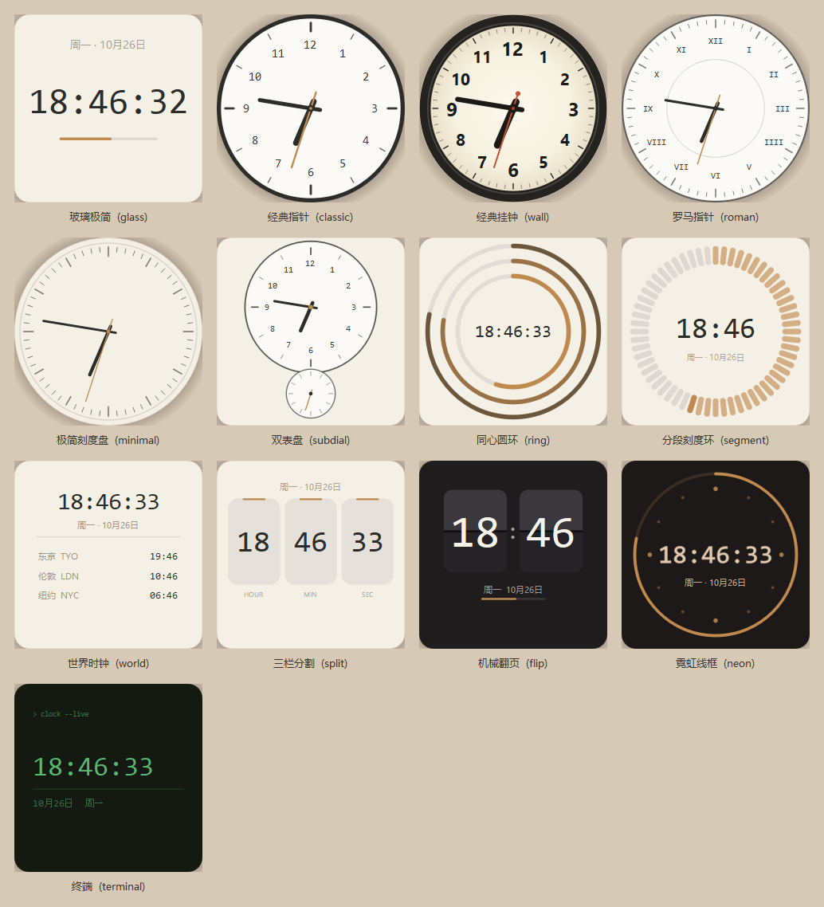

# 桌面时钟 DesktopClock

一个给 Windows 用的桌面时钟挂件。13 套矢量皮肤、10 套配色、三档窗口层级，界面全部用 QPainter 自绘，**不加载任何图片资源**，常驻内存约 47 MB，空闲 CPU 0.00%。




---

## 特性

- **13 套皮肤** —— 数字、指针、图形三类，从极简玻璃到机械翻页、霓虹、终端
- **圆形皮肤圆外透明** —— 指针类皮肤只画表盘本身，四个角不留卡片底色，直接融进壁纸
- **指针与刻度可单独调粗细** —— 两个 0.5–3.0 的倍数滑杆，0.1 一档，各调各的
- **10 套主题配色** —— 暖米 / 墨黑 / 冷灰 / 青瓷 / 琥珀 / 樱粉 / 深海 / 极简白 / 石墨 / 纸白
- **三档窗口层级** —— 始终置顶 / 普通窗口 / 桌面挂件层（挂在壁纸之上、图标之下）
- **完全无边框** —— 拖拽移动、滚轮缩放、边缘吸附、圆角与投影可调
- **毛玻璃背景** —— 可选系统 DWM 模糊
- **农历与二十四节气** —— 纯离线天文算法，不联网
- **多时区** —— 世界时钟皮肤支持最多 4 个副城市
- **极省资源** —— 矢量绘制、定时器对齐整秒边界、零常驻轮询
- **崩溃与卡死自愈** —— 异常全部落日志，定时器停摆会自动重启

---

## 环境要求

| 项 | 要求 |
|---|---|
| 系统 | Windows 10 / 11（64 位） |
| Python | 3.9 及以上（仅源码运行需要） |
| 依赖 | PyQt5 5.15、tzdata |

---

## 快速开始

```bash
git clone https://github.com/tiantianw/desktop-clock.git
cd desktop-clock

python -m venv .venv
.venv\Scripts\pip install -r requirements.txt

.venv\Scripts\pythonw run.pyw
```

也可以直接双击 `start_clock.vbs`（无控制台窗口）。

启动后时钟出现在屏幕右上角，同时系统托盘出现一个表盘图标。

### 启动参数

```
run.pyw --settings      # 启动后直接弹出设置面板
```

### 退出

右键时钟 → **退出**，或托盘图标右键 → **退出**。

---

## 打包成单个文件夹

```bash
.venv\Scripts\pip install pyinstaller
.venv\Scripts\python -m PyInstaller build_tools/DesktopClock.spec --noconfirm
```

产物在 `dist/DesktopClock/`，整个文件夹可拷到任何 Windows 10/11 机器上直接运行，不需要装 Python。

spec 里做了三层裁剪：`BLOCK_BIN` 黑名单剔除无用 DLL、插件白名单只留 `qwindows`/`qico`、`TZ_KEEP` 只保留城市表用到的时区文件。成品 45 MB / 89 个文件。

---

## 操作

| 操作 | 效果 |
|---|---|
| 左键拖动 | 移动位置 |
| 滚轮 | 缩放（80–600 px） |
| 双击 | 切换 12 / 24 小时制 |
| 右键 | 打开快捷菜单 |
| 靠近屏幕边缘松开 | 自动吸附 |
| `Ctrl+Alt+T` | 循环切换三档层级 |
| `Ctrl+Alt+H` | 显示 / 隐藏 |

托盘图标单击 = 显示 / 隐藏，右键 = 完整菜单。

> 桌面挂件层下鼠标事件由桌面接管，无法拖动时钟，需先用快捷键或托盘切回其它档位。

---

## 13 套皮肤

| 皮肤 | 特点 | 适合 |
|---|---|---|
| 玻璃极简 | 大号等宽数字 + 秒进度条 | 浅色壁纸，最干净 |
| 经典指针 | 黑框白面、阿拉伯数字、红秒针 | 传统挂钟手感 |
| 经典挂钟 | 粗黑外框 + 米白弧面表盘 + 粗黑指针 + 红秒针 | 最像墙上那只实体钟 |
| 罗马指针 | 罗马数字、细边框 | 古典气质 |
| 极简刻度盘 | 无数字，只有刻度与细针 | 极简桌面 |
| 双表盘 | 主盘看时分，小盘走秒 | 机械表爱好者 |
| 同心圆环 | 三段圆弧 = 时 / 分 / 秒 | 现代感 |
| 分段刻度环 | 60 格逐格点亮 | 有「走过的时间」感 |
| 世界时钟 | 主时间 + 最多 4 个城市 | 跨时区工作 |
| 三栏分割 | 时 / 分 / 秒 三个独立方块 | 信息密度高 |
| 机械翻页 | 深色翻页卡片 | 机场翻牌钟质感 |
| 霓虹线框 | 暗底发光圆环 | 深色壁纸 |
| 终端 | 等宽绿字 + 闪烁光标 | 极客风 |

切换方式：右键 → **皮肤**，或托盘菜单 → **皮肤**，或设置面板第一页点缩略图。

> 翻页 / 霓虹 / 终端三款自带深色底，不受「背景设置」影响，这是设计如此。

> 经典指针 / 经典挂钟 / 罗马指针 / 极简刻度盘四款是**圆形表盘**：圆外区域完全透明，
> 投影也跟着变成圆形，四个角不会留一张卡片底色，直接融进壁纸。
> 「圆角」设置对它们不起作用，圆角就是圆的。这四款也不支持毛玻璃背景——
> 系统模糊只能作用于整个窗口矩形，套在圆上会糊出一个方块，所以会自动退回填充。

---

## 三档窗口层级

右键 → **层级**，或托盘菜单，或快捷键 `Ctrl+Alt+T` 循环。

| 档位 | 效果 |
|---|---|
| **始终置顶** | 压在普通窗口之上，永远可见。每 5 秒自动校验，防止被其它置顶窗口挤下去 |
| **普通窗口** | 和普通窗口一样，会被遮挡 |
| **桌面挂件层** | 挂在壁纸之上、桌面图标之下，像「长在桌面上」。被任何窗口遮挡，切回桌面才看得到 |

技术说明：桌面挂件层先用 `Progman` 触发 `WorkerW` 分裂，再 `SetParent` 挂载。切到这一档时程序会重建窗口（改父窗口会破坏 Qt 的透明表面），会看到一次短暂闪烁，属正常现象。挂载失败会自动降级为置顶并写日志。

---

## 设置面板

右键 → **设置…**。四个分页，**所有改动即时生效，不用重启**。

- **皮肤** —— 13 套缩略图，用当前配色实时渲染
- **外观** —— 大小 80–600 px、圆角 0–40 px、10 套主题预设、背景 / 文字 / 强调 / 描边色、背景模式（无底 / 填充 / 毛玻璃）、不透明度、描边与投影开关、字体与字重、**指针粗细 / 表盘刻度**
- **内容** —— 12/24 小时制、显示秒、秒针样式（跳秒 / 平滑扫秒 / 不显示）、日期格式、星期显示、农历节气、副时区城市
- **行为** —— 层级、置顶守护、锁定位置、点击穿透、边缘吸附、开机自启

### 指针与刻度

两个互相独立的倍数，默认都是 `1.0`，步进 `0.1`，范围 `0.5 – 3.0`：

| 设置 | 作用范围 |
|---|---|
| **指针粗细** | 时 / 分 / 秒三根针的线宽，以及中心轴帽大小。长度不变 |
| **表盘刻度** | 刻度线的宽度与长度、表盘数字的字号 |

表盘刻度只对指针类皮肤（经典指针 / 经典挂钟 / 罗马指针 / 极简刻度盘 / 双表盘）生效，数字皮肤和图形皮肤没有刻度可调。数值上有保护上限，防止拉满时数字糊到表盘外面去；想让整体更大请直接调「时钟大小」。

---

## 配置文件

位置：程序目录下的 `config.json`（打包版在 exe 同级目录），首次运行后生成。手工改完重启程序生效，删掉即恢复默认。

```json
{
  "skin": "glass",
  "theme": "warm",
  "geometry": { "x": null, "y": null, "size": 110 },
  "layer": "topmost",
  "appearance": {
    "radius": 18,
    "bg_mode": "solid",
    "bg_color": "#FAF6EE",
    "bg_opacity": 92,
    "accent": "#C08A4E",
    "text_color": "#2C2C2A",
    "muted_color": "#A0937F",
    "font_family": "Consolas",
    "font_weight": 500,
    "shadow": true,
    "shadow_strength": 20,
    "border": true,
    "border_color": "#E7DFD2",
    "dial_style": "arabic",
    "hand_scale": 1.0,
    "dial_scale": 1.0
  },
  "content": {
    "hour24": true,
    "show_seconds": true,
    "second_style": "tick",
    "date_format": "MM月DD日",
    "show_weekday": "short",
    "show_lunar": false,
    "sub_timezones": [],
    "blink_cursor": true
  },
  "behavior": {
    "lock_position": false,
    "click_through": false,
    "edge_snap": true,
    "autostart": false,
    "topmost_guard": true,
    "hotkey_layer": "Ctrl+Alt+T",
    "hotkey_visible": "Ctrl+Alt+H"
  }
}
```

`geometry.x` / `geometry.y` 为 `null` 时自动放在右上角。

---

## 项目结构

```
DesktopClock/
├── run.pyw                 入口
├── start_clock.vbs         无窗口启动脚本
├── requirements.txt
├── app/
│   ├── window.py           主窗口：无边框、阴影、拖动缩放、层级切换
│   ├── tray.py             托盘图标与菜单
│   ├── settings_dialog.py  设置面板
│   └── single_instance.py  单实例锁
├── render/
│   ├── base.py             皮肤基类 + 绘制工具
│   ├── registry.py         皮肤注册表
│   ├── skins_dial.py       指针类
│   ├── skins_digital.py    数字类
│   └── skins_shape.py      图形类
├── core/
│   ├── config.py           配置读写 + 主题预设
│   ├── lunar.py            农历 + 节气（天文算法）
│   ├── timezones.py        时区城市表
│   └── logger.py           异常兜底与崩溃取证
├── sysint/
│   ├── win32.py            置顶 / 桌面层 / 穿透 / 毛玻璃
│   ├── autostart.py        开机自启
│   └── hotkey.py           全局快捷键
├── assets/                 图标与皮肤总览图
└── build_tools/            打包 spec、预览渲染、冒烟测试、诊断脚本
```

---

## 自己加一套皮肤

1. 在 `render/skins_digital.py`（或任意 `skins_*.py`）里继承 `Skin`
2. 实现 `draw(self, p, rect, now, cfg)`
3. 用 `rect` 的比例排版，不要写死像素，这样任意尺寸都好看
4. 加进 `render/registry.py` 的 `SKINS` 列表

`render/base.py` 提供了 `num_font` / `ui_font` / `color` / `draw_text` / `hand` / `arc_clock` / `round_rect` / `dot` 等工具，照抄现有皮肤的写法即可。

---

## 性能

| 指标 | 实测 |
|---|---|
| 内存 RSS | 约 47 MB |
| CPU（跳秒，空闲） | 0.00 % |
| CPU（平滑扫秒） | 约 1–3 % |
| 启动耗时 | < 1 秒 |
| 磁盘（源码） | < 200 KB，无任何图片素材 |
| 磁盘（打包版） | 45 MB，89 个文件 |

省资源的关键做法：

- 皮肤全部 QPainter 矢量绘制，**零图片资源**
- 定时器对齐到整秒边界触发，不跑常驻轮询
- 设置面板延迟加载（打开才载入字体库与取色器）
- 打包时剔除 QtNetwork / QtQml / QtQuick / QtWebEngine / QtMultimedia / OpenGL 软件渲染库、全部 Qt 翻译文件、OpenSSL，以及 tzdata 里没用到的 590 个时区文件

---

## 常见问题

日志位置：程序目录 `logs/desktopclock.log`。所有异常都会写进去，程序不会静默崩溃。另有 `logs/crash.log` 记录硬崩溃（访问违例、abort）和卡死时的线程栈。

| 现象 | 处理 |
|---|---|
| 双击没反应 | 可能已有实例在跑（单实例锁），看托盘有没有图标 |
| 时钟找不到 | 托盘菜单 → 重置到右上角；或检查是否设成了「点击穿透」 |
| 桌面挂件层看不到时钟 | 该档位被所有窗口遮挡是正常的，切回桌面才可见 |
| 透明失效、背景变黑 | 远程桌面下 DWM 合成关闭，透明会失效，改用「填充」背景模式 |
| 毛玻璃没效果 | 系统版本差异，改回「填充」模式即可 |
| 开机没自启 | 检查 `HKCU\Software\Microsoft\Windows\CurrentVersion\Run` 下有没有 `DesktopClock` 项；部分安全软件会拦截注册表写入 |
| 改了配置不生效 | 配置在退出时写盘，确保用菜单退出而非强杀进程 |
| 时间不走（画面定格） | 内置自愈会在停摆超过约 5 秒时自动重启刷新定时器，并在日志里留一行 `!! 刷新停摆`。若反复出现，请附上 `logs` 目录提 issue |

### 画面定格是怎么防的

实测遇到过一种失效：进程活着、窗口也在、消息循环正常，但 Qt 的刷新定时器不再触发，时间永远停在某一刻（CPU 为 0）。这种状态下 QTimer 自己救不了自己，所以做了三层兜底：

1. **界面看门狗**（每 2.5 秒）—— 发现刷新停摆超过 `间隔 × 2.5 + 3` 秒，记日志并重启定时器
2. **后台线程看门狗** —— GUI 线程整体卡死时界面看门狗也会一起停摆，由独立线程把全部线程栈写进 `crash.log`，并用窗口消息（`WM_APP+0x51`）唤醒主线程
3. **faulthandler** —— 硬崩溃（访问违例、abort）时把 C 层堆栈写进 `crash.log`

---

## 说明

本项目暂未附带开源许可证文件。如需在其它项目中使用，请先联系作者。
